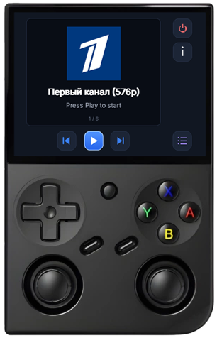

# OnlineTV for Anbernic RG35XXPRO (Knulli)

Python + pygame front-end with mpv as the video back-end.

Tested on Knulli `scarab-20260511`:
- Python: 3.12.8
- pygame: 2.5.2 (SDL 2.32.8)
- mpv: /usr/bin/mpv

## Install
1. **Automatic (recommended):** download **rg35xx_online_tv.zip** release file and install via [PortMaster autoinstall](https://portmaster.games/faq.html#do-i-have-to-use-portmaster-to-install-ports)

    **Manual:** Copy the contents of **zip** file to `/userdata/roms/ports/` on the device (you get `OnlineTV.sh` plus the `onlinetv/` folder)
2. Refresh the game list
3. Start `Online TV` from ports menu

**Don't forget to connect to the Wi-Fi network!**

## Controls
D-pad moves focus, **A** activates, **B** goes back / leaves full-screen / closes list and settings.
Keyboard fallback for desktop testing: arrows, Enter/Z = A, Esc/X = B (`APP_WINDOWED=1 python3 main.py`).

## Playback on Knulli
This device's mpv only has the `sdl` video output, which is always full-screen (no drm/gpu/compositor),
so a windowed preview is not possible. While a channel plays, the app hands the display to mpv:
**A** pause/resume, **Left/Right** previous/next channel, **B** stop and return to the interface.
Env overrides: `MPV_VO`, `MPV_HWDEC` (default `no`, software decoding).

## Debug
`APP_DEBUG=1` (set in `OnlineTV.sh`) writes errors and button presses to `onlinetv/onlinetv.log`
and mpv's stderr to `onlinetv/mpv.log`.

## Channels
Edit `ports/onlinetv/channels.json` (`name`, `url` and `type` per channel). The bundled entries are public test streams.
Type values are `tv` and `radio`.
The `logo` field is the channel logo in base64 format (optional).

## Files
- `main.py` - state machine (main / list / settings / full-screen), input, focus navigation
- `interface.py` - all drawing (layout constants from the spec, icons drawn with `pygame.draw`)
- `mpv.py` - starts/stops mpv, pause + full-screen via JSON IPC, kills the process group on exit

### TODO

- Settings?
